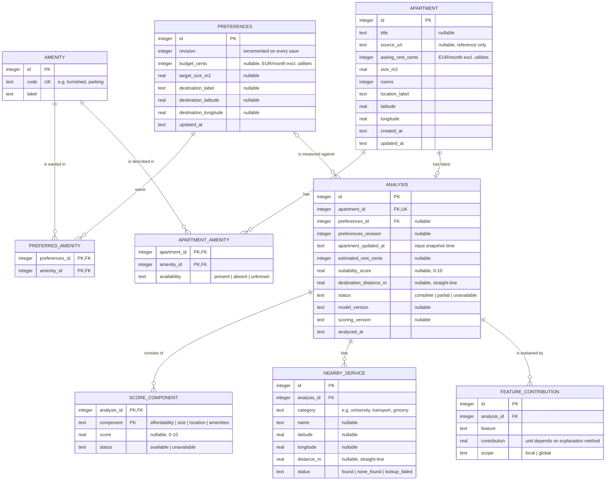

# Roomzy: Entity-Relationship Model

Status: Draft for team review. This model describes the planned on-device SQLite database. It refines the initial data model in the [technical design](TECHNICAL-DESIGN.md) by turning its JSON columns (amenities, score components, location results, explanation) into separate entities.

Training data and model artifacts are not part of this model: they live in a separate, versioned dataset on the ML side, and the device only records which model and scoring version produced an analysis.

## Diagram

## Entities

| Entity | Meaning |
| --- | --- |
| **Preferences** | The student's single profile of budget, target size, destination and desired amenities. Every field can stay unset until entered. |
| **Amenity** | A fixed list of amenities the app knows about (for example furnished, parking). Shared by preferences and apartments, so both use the same codes. |
| **Preferred amenity** | Which amenities the student wants. |
| **Apartment** | An apartment the student entered manually, with its asking rent and characteristics. |
| **Apartment amenity** | Whether an apartment has a given amenity. `unknown` is stored explicitly so it is never confused with `absent`. |
| **Analysis** | The latest snapshot of results for one apartment: estimated rent, suitability score and location results. |
| **Score component** | One criterion of the suitability score, each shown on its own. |
| **Nearby service** | A service found (or looked for) near the apartment during location analysis. |
| **Feature contribution** | One line of the explanation of the estimated rent, labelled as either specific to this apartment (`local`) or model-wide (`global`). |

## Relationships and cardinalities

| Relationship | Cardinality | Rule |
| --- | --- | --- |
| Preferences – Amenity (via Preferred amenity) | M:N | A student can want several amenities; an amenity can be wanted or not. |
| Apartment – Amenity (via Apartment amenity) | M:N | Each row records availability as present, absent or unknown. |
| Apartment – Analysis | 1 : 0..1 | An apartment keeps at most its latest analysis (`apartment_id` is unique). A new analysis replaces the old one; deleting an apartment deletes its analysis. |
| Preferences – Analysis | 0..1 : 0..N | An analysis references the preferences it was scored against, or none if only a rent estimate was produced. |
| Analysis – Score component | 1 : 0..4 | One row per criterion; deleted with the analysis. |
| Analysis – Nearby service | 1 : 0..N | Deleted with the analysis. |
| Analysis – Feature contribution | 1 : 0..N | Deleted with the analysis. |

## Rules carried over from the design

- Money is stored as integer EUR cents; rent always means EUR/month excluding utilities and deposits.
- Missing values are `NULL`, never `0`. A service that could not be looked up (`lookup_failed`) is different from one confirmed not to exist (`none_found`).
- The asking rent is never an input to the estimated rent; the two are only compared after prediction.
- An analysis is outdated when `apartment_updated_at` differs from the apartment's `updated_at`, or `preferences_revision` differs from the current preferences revision.
- `model_version` and `scoring_version` record how a result was produced, so results from different versions are not compared as equal.
- Distances are straight-line and labelled as such, never presented as walking time.

## Open points

These depend on decisions still open in `CONTEXT.md`, so the model may change:

- Apartment fields and the amenity list depend on the dataset that is chosen.
- `Feature contribution` assumes the explanation can be expressed per feature; its unit and scope depend on the explanation method.
- The scoring components and their 0–10 normalization are not agreed yet.
