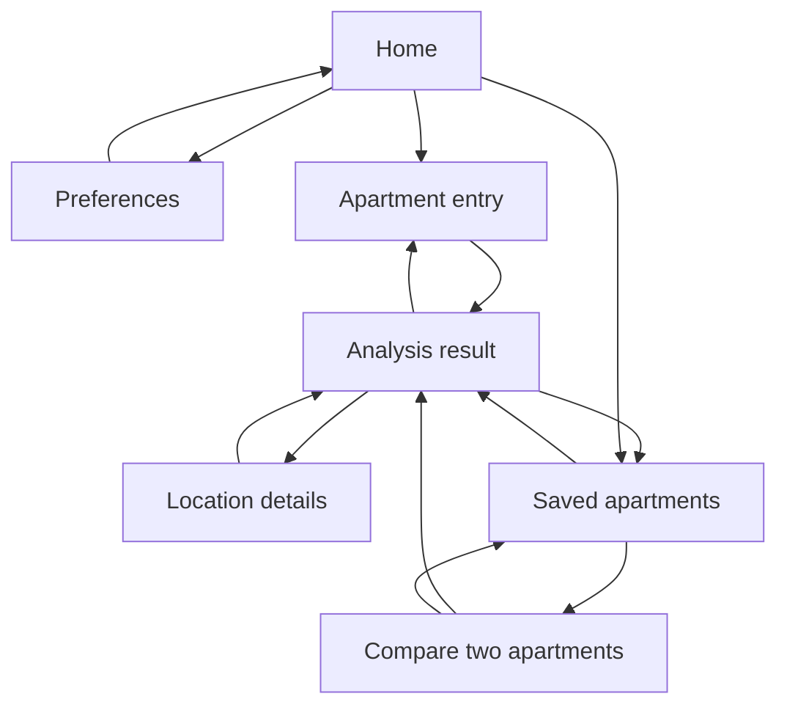

# Roomzy: Screen Wireframes and Navigation

Status: Draft for review. These text wireframes are the initial prototype, not screenshots of a working application. All apartment values and results below are illustrative and are not model outputs or verified market data.

## Navigation



Home, Analyze, and Saved are the primary navigation destinations. Preferences is accessible from Home. Back navigation returns to the previous screen and preserves unfinished form input. The explanation expands within the result screen.

## S-01: Home and preferences

```text
+------------------------------------+
| roomzy.              [Preferences]  |
| Smarter renting starts here.        |
|                                    |
| [ Analyze an apartment           ]  |
| [ Saved apartments               ]  |
|                                    |
| Budget: EUR 650/month               |
| Destination: Selected university   |
|                                    |
| Home          Analyze        Saved |
+------------------------------------+

+------------------------------------+
| < Back                 Preferences |
| Rent budget/month      [650      ]  |
| Target size, square m  [35       ]  |
| Destination            [Search   ]  |
| Confirm destination    [Map pin  ]  |
| Desired amenities                  |
| [x] Furnished  [ ] Parking         |
|                                    |
| [ Save preferences               ]  |
+------------------------------------+
```

Budget excludes utilities and deposits. Destination search requires a confirmed result. Missing preferences are shown as not set. Changing preferences flags existing personalized scores for recalculation.

## S-02: Apartment entry

```text
+------------------------------------+
| < Back           Analyze apartment |
| Title, optional        [Apartment A]|
| Asking rent/month, EUR [620        ]|
| Size, square m         [35         ]|
| Rooms                  [1          ]|
| Location               [Search     ]|
| [ Confirm location on map        ] |
| Amenities                          |
| Furnished [Yes / No / Unknown]      |
| Parking   [Yes / No / Unknown]      |
| Source URL, optional   [           ]|
|                                    |
| [ Analyze                        ] |
+------------------------------------+
```

Required fields are asking rent, size, room count, and a confirmed location. Field definitions will be checked against the selected dataset before implementation. Unknown amenities are distinct from absent amenities. A source URL is stored as a reference; pasting it does not import listing data.

While analysis runs, show a loading state and prevent duplicate submissions. On failure, preserve all input and provide Retry and Save without analysis actions. An incomplete form remains editable and cannot be submitted as a valid analysis request.

## S-03: Analysis result

```text
+------------------------------------+
| < Back                 Apartment A |
| Asking rent           EUR 620/mo   |
| Estimated rent        EUR 590/mo   |
| Asking rent is EUR 30 above estimate|
| Rent excludes utilities/deposit    |
|                                    |
| Suitability                  7.8/10 |
| [ View score components          ] |
| [ Why this estimate?             ] |
| [ Location and nearby services   ] |
|                                    |
| Analyzed: example date             |
| Model: example-version             |
| [ Edit ]       [ Save apartment ]  |
+------------------------------------+
```

The explanation distinguishes prediction factors from suitability criteria. If only model-wide importance is available, its label says so. The score component section shows the criteria and their contributions once the scoring formula is approved.

If analysis is partial, show available values and an explicit incomplete status. A complete overall suitability score is withheld when a required component is unavailable. An unavailable model never produces a placeholder prediction. Old saved results show an outdated label and a Recalculate action.

## S-04: Location details

```text
+------------------------------------+
| < Back                    Location |
| +--------------------------------+ |
| | Map: apartment, destination,    | |
| | and available nearby services  | |
| +--------------------------------+ |
| Straight-line distances            |
| University                  1.2 km |
| Public transport stop       250 m  |
| Grocery store               400 m  |
|                                    |
| Location data: example timestamp   |
+------------------------------------+
```

Distances in this draft are straight-line distances. Walking times and routing are outside the proposed first version. The text list remains useful if the map fails or cannot be used with assistive technology. Unavailable services receive a message rather than an invented distance.

## S-05: Saved apartments

```text
+------------------------------------+
| Saved apartments                  |
| [x] Apartment A   EUR 620   7.8/10  |
| [x] Apartment B   EUR 680   8.1/10  |
| [ ] Apartment C   EUR 590   Pending |
|                                    |
| Select two apartments to compare.  |
| [ Compare selected               ] |
|                                    |
| Home          Analyze        Saved |
+------------------------------------+
```

Tapping an apartment opens its details. Selection controls are separate from the detail action. Compare is available only when exactly two apartments are selected. An empty list offers Analyze an apartment. Delete is available from saved details and requires confirmation.

## S-06: Comparison

```text
+------------------------------------+
| < Back                    Compare |
|                  Apt A     Apt B   |
| Asking rent      EUR 620   EUR 680  |
| Estimated rent   EUR 590   EUR 650  |
| Size             35 m2     42 m2    |
| Rooms            1         2        |
| University       1.2 km    0.8 km   |
| Furnished        Yes       Unknown  |
| Suitability      7.8       8.1      |
|                                    |
| [ View A ]             [ View B ]  |
+------------------------------------+
```

Use the same units and criteria for both columns. Show unknown or stale values explicitly. If preferences or model versions differ, explain that recalculation is needed for a consistent comparison. Avoid color as the only indicator of a difference.

## Prototype review

These wireframes allow review of the information and navigation before visual design. Before final submission, the team should confirm whether this level of fidelity is sufficient or replace the wireframes with visual mockups. If a separate design tool is used, add exported images to this folder and link the editable prototype here.

Review the screens against [UC-01 through UC-05](USER-SCENARIOS.md), including empty, loading, error, incomplete, and outdated states.
