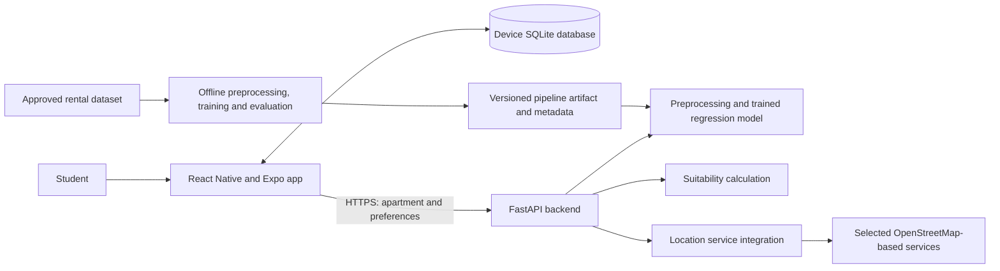
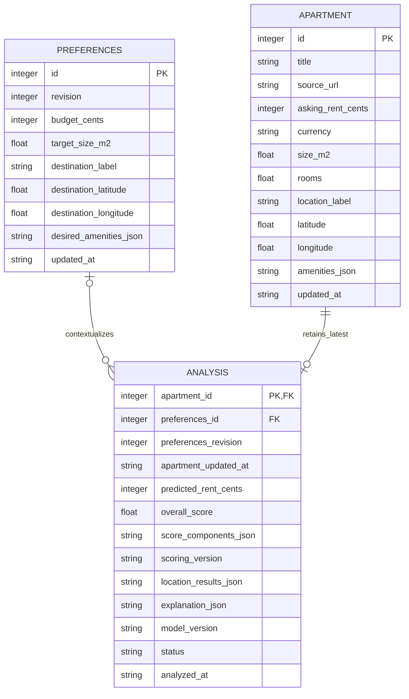

# Roomzy: Technical Design

Status: Proposed architecture and data model, awaiting review. No application implementation or trained model is included in this documentation draft.

## Architecture

The mobile app collects inputs, presents results, and stores preferences, apartments, and the latest saved analysis locally. The proposed backend does not maintain user accounts or a shared database of saved apartments. It validates analysis requests, runs inference, gathers location information, and returns results.

Training runs separately from the deployed request path. A model artifact contains the fitted preprocessing pipeline and predictor; accompanying metadata records its version, supported coverage, input schema, rent definition, and evaluation results.

## Planned technologies

| Area | Technology | Intended purpose |
| --- | --- | --- |
| Mobile | React Native, Expo, TypeScript | Mobile interface, navigation, and interaction with the backend. |
| API | Python, FastAPI | Input validation and analysis endpoints. |
| ML | scikit-learn; XGBoost as a candidate | Preprocessing, baseline evaluation, and regression model comparison. The final estimator depends on results. |
| Storage | SQLite on the device | Saved apartments, preferences, and analysis snapshots. The Expo-compatible storage integration remains to be selected. |
| Location | Selected OpenStreetMap-based services | Geocoding, map display, and nearby-service lookup. Exact providers remain undecided. |
| Automation | GitHub Actions | Initial documentation checks, followed by code checks as components are added. |

Provider selection must include attribution requirements, coverage, usage limits, and suitability for the planned workload. "OpenStreetMap APIs" in the README is a technology direction, not a confirmed single provider for every map function. Hosting and deployment targets remain undecided.

## Runtime data flow

1. The app validates apartment details and confirms the selected location.
2. It sends the property inputs and applicable preferences to the backend.
3. The backend validates the request against the supported input schema and coverage.
4. The fitted pipeline predicts rent without receiving the asking rent as a prediction feature.
5. Location analysis supplies available distance and nearby-service information. Suitability calculation uses its own approved rules.
6. The response identifies which components succeeded and includes the analysis time and model version.
7. If the student saves the apartment, the app stores its details and available analysis in local SQLite.

Location data failures may produce a partial result. A missing model produces an explicit unavailable prediction. The system must not substitute demonstration values for either case.

## Initial data model

- Preferences is a single local profile. Its scoring inputs may remain unset until entered; each saved change increments its revision.
- Each apartment retains at most one analysis snapshot. Saving a new analysis replaces that snapshot. Deleting an apartment deletes its analysis.
- An analysis may have no preferences reference if only a rent estimate was requested. Missing prediction or score values are null, not zero.
- Amenity values distinguish present, absent, and unknown. Structured result fields retain component availability and the preference inputs used for the calculation.
- Comparing stored input timestamps and preference revisions identifies outdated results. Model and scoring versions identify how results were produced.
- Monetary amounts are stored as integer EUR cents. Display formatting uses EUR per month, excluding utilities and deposits.
- Training observations are a separate versioned dataset, not rows in the device database. No landlord contact information is required.

This model is a starting point; exact required fields depend on the approved dataset and scoring rules.

## Proposed API boundary

| Operation | Purpose | Main response |
| --- | --- | --- |
| `POST /analysis` | Analyze validated apartment details and optional preferences. | Prediction, score components, location results, explanation, timestamps, versions, and component availability. |
| `GET /model-info` | Identify the currently loaded model and supported coverage. | Model version, input requirements, rent definition, coverage, and availability. |
| `GET /health` | Check whether the backend process responds. | Service status; model readiness is reported separately. |

These are proposed contracts. Location search and map integration are specified when providers are selected; any provider credentials must remain on the backend if they are secret. Saved apartments do not require backend CRUD endpoints in the proposed local-storage design.

## ML development and evaluation

1. **Select data:** Record source, permitted use, collection period, geographic coverage, sample count, units, and whether the target is advertised or contracted rent. If the source contains asking rents, describe predictions as estimates of advertised rent.
2. **Prepare inputs:** Standardize rent definitions, remove unusable rows and duplicate listings, handle missing data, and document the retained features. Fit learned preprocessing only on training data.
3. **Split before fitting:** Keep repeated versions of the same property in one partition. Prefer a chronological holdout when collection dates support it; otherwise document the grouped split and its limitations.
4. **Establish a baseline:** Compare candidate models against a simple training-set median-rent predictor. Evaluate a basic regression approach before increasing complexity.
5. **Evaluate:** Report mean absolute error in EUR/month, with RMSE as a secondary metric, on a held-out test set. Examine errors by location and apartment size where sample counts permit. Set a useful accuracy target after inspecting the data, rather than inventing a result now.
6. **Export:** Store the selected pipeline with metadata and reproducible training instructions. Keep a record of the dataset version and evaluation split.
7. **Explain:** Select an explanation compatible with the trained estimator. Distinguish local explanations from global feature importance. Do not claim a calibrated prediction interval unless it has been evaluated.

Dataset acquisition is the main unresolved dependency. If representative rental data cannot be obtained, the team must revise coverage or scope rather than present an unvalidated model as reliable.

## Suitability and location rules

Suitability is separate from the regression model. Proposed components are affordability relative to the user's rent budget, size relative to the target size, proximity to a chosen destination and useful services, and desired-amenity matches.

Before implementation, define component formulas, normalization to 0–10, weights, unknown-value handling, and a scoring version. A complete overall score is withheld when a required component is unavailable; available components remain visible. The same preferences and scoring version must be used for a fair comparison.

The first location design uses straight-line distance, clearly labeled. It does not infer walking time from distance. A failure to retrieve a nearby service is distinguished from a confirmed absence of that service.

## Validation and data handling

Validate numeric ranges, supported geography, coordinate bounds, and request size at the API boundary. Treat entered URLs as references; the backend does not fetch arbitrary URLs. Load model artifacts only from trusted team-produced releases.

Use HTTPS for deployed requests and avoid logging apartment addresses, preferences, or complete request bodies unnecessarily. Device records remain until deleted or application data is removed; the proposed version provides no backup or synchronization. Actual request retention and provider data handling must be documented once hosting and providers are selected.

Tests should cover invalid inputs, unavailable models, partial location results, stale saved analyses, and consistent scoring and comparison. See the [development plan](DEVELOPMENT-PLAN.md) for the planned implementation sequence.
